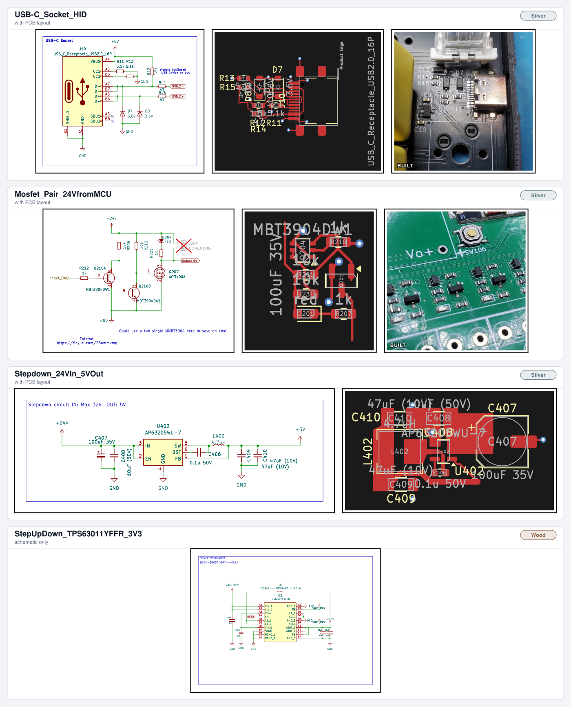

# KiCad Design Blocks

[](https://github.com/mrred2k/Kicad_Design_Blocks/actions/workflows/generate-previews.yml)
[](#requirements)
[](CONTRIBUTING.md)

Stop redrawing the same 3V3 LDO, the same USB-C receptacle and the same buck
converter in every new project.

This repository collects those fragments as **design blocks**: a schematic you drop
into your sheet, plus — where available — the matching PCB layout, with footprints,
values and LCSC part numbers already assigned. Add the repo as a Git submodule, point
KiCad at it, and the blocks show up in the Design Block palette of the Schematic and
PCB editors.



**Reading the image:** left half = schematic, right half = PCB layout — or, if the block
already runs on a board, a photo of the assembled circuit (marked `BUILT`). The corner
badge is the block's [quality tier](CONTRIBUTING.md#quality-scale); blocks that ship no
layout say `schematic only` under the name.

## Requirements

| | |
|---|---|
| **KiCad** | 10.0 or newer. Schematic design blocks arrived in KiCad 9, PCB design blocks in KiCad 10 — this library uses both. |
| **Git** | Anything that supports submodules. |

## Using the blocks in a project

### 1. Add the library once

```bash
git submodule add https://github.com/mrred2k/Kicad_Design_Blocks.git kicad-design-blocks
git commit -m "Add kicad-design-blocks submodule"
```

### 2. Point KiCad at it

**Preferences → Manage Design Block Libraries → Add:**

| Nickname | Path |
|----------|------|
| `blocks` | `${KIPRJMOD}/kicad-design-blocks/blocks.kicad_blocks` |

This writes a `design-block-lib-table` into your project folder — commit it, so the
next person cloning your project gets the same library binding.

### 3. Place a block

Open the **Design Blocks** panel (Schematic Editor, right dock), pick a block, click
the canvas. Most blocks arrive with reference designators already unique-ish and with
hidden power symbols; reconnect `+3V3`, `+5V`, `GND` and the I/O labels to your own
nets.

PCB blocks live in the PCB Editor's Design Blocks panel. Place the schematic part
first, then the layout inside the same project so both stay in sync.

### Clone a project that already uses this library

```bash
git clone --recurse-submodules <project-url>
# already cloned?
git submodule update --init
```

### Pull new blocks into an existing project

```bash
git submodule update --remote kicad-design-blocks
git add kicad-design-blocks
git commit -m "Update kicad-design-blocks"
```

## What is inside a block

```
blocks.kicad_blocks/
└── <BlockName>.kicad_block/
    ├── <BlockName>.kicad_sch    # Schematic fragment
    ├── <BlockName>.kicad_pcb    # PCB layout fragment (optional)
    ├── <BlockName>.json         # Description, keywords, metadata fields
    ├── <BlockName>_preview.svg  # Generated by CI
    └── README.md                # Generated by CI (BOM + badges)
```

The `.json` is the contract: `description` and `keywords` are what KiCad shows in the
block browser, and the metadata fields decide the quality tier
([quality scale](CONTRIBUTING.md#quality-scale)):

| Field | Meaning |
|-------|---------|
| `maturity` | `schematic` → `layout` → `produced` |
| `lcsc_parts` | LCSC part numbers assigned to every component |
| `jlcpcb_basic` | Parts picked from the JLCPCB Basic list where possible |
| `has_3d` | 3D models assigned (`yes` / `partial` / `no`) |
| `reviewed` | Second pair of eyes looked at it |

A **Silver** block is the usual target: layout included, LCSC numbers everywhere, no
JLCPCB Extended-part surcharges.

## Contributing a block

1. In the Schematic Editor: select the circuit → right click → **Save as Design Block**
2. Choose the `blocks` library, fill in name, keywords, description and metadata
3. Optionally save the matching PCB layout as a design block in the PCB Editor
4. Open a pull request

CI then renders your block, posts the preview and a BOM as a PR comment, and flags
metadata problems. Full details: [CONTRIBUTING.md](CONTRIBUTING.md).

## Automation

Nothing in this repo is drawn by hand twice. Three workflows keep it consistent:

| Workflow | Trigger | What it does |
|----------|---------|--------------|
| **Validate design blocks** | PR touching `blocks.kicad_blocks/` | Checks every block has schematic, `.json`, description and valid metadata |
| **PR block preview** | PR touching `blocks.kicad_blocks/` | Renders new/changed blocks, posts preview + BOM + JLCPCB hints as a PR comment |
| **Generate block previews** | push to `main` | Re-renders every block preview and refreshes the per-block README + BOM, commits the result |

## KiCad documentation

- [Schematic design blocks](https://docs.kicad.org/10.0/en/eeschema/eeschema.html#schematic-design-blocks)
- [PCB design blocks](https://docs.kicad.org/10.0/en/pcbnew/pcbnew.html#pcb-design-blocks)
