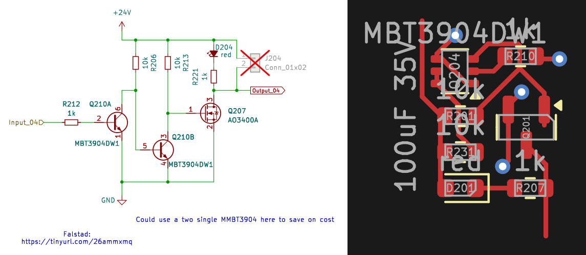

<!-- AUTO-GENERATED — do not edit, this file is overwritten on every push to main -->

# Mosfet_Pair_24VfromMCU

 

Low-side switch for 24V loads, BJT-driven N-ch MOSFET (AO3400A), active high, MCU-compatible input, status LED included

## Bill of Materials

*Manufacturer, MPN and JLCPCB class fetched automatically from the [JLCPCB parts API](https://jlcpcb.com/parts).*

| Refs | Value | Footprint | LCSC | JLCPCB | Manufacturer | MPN | Category |
| --- | --- | --- | --- | --- | --- | --- | --- |
| D204 | red | LED_0603_1608Metric | C2286 | Basic | Hubei KENTO Elec | KT-0603R | LED Indication - Discrete |
| Q207 | AO3400A | SOT-23 | C20917 | Basic | Alpha & Omega Semicon | AO3400A | MOSFETs |
| Q210, Q210 | MBT3904DW1 | SOT-363_SC-70-6 | C110150 | Extended | onsemi | MBT3904DW1T1G | Bipolar (BJT) |
| R206, R213 | 10k | R_0603_1608Metric | C25804 | Basic | UNI-ROYAL(Uniroyal Elec) | 0603WAF1002T5E | Chip Resistor - Surface Mount |
| R212, R221 | 1k | R_0603_1608Metric | C21190 | Basic | UNI-ROYAL(Uniroyal Elec) | 0603WAF1001T5E | Chip Resistor - Surface Mount |

---
*Keywords: mosfet mcu low-side switching*

| | |
|---|---|
| Maturity | Produced |
| LCSC Parts | Yes |
| JLCPCB | Optimized for Basic Parts |
| 3D Models | Yes |
| Reviewed | No |
