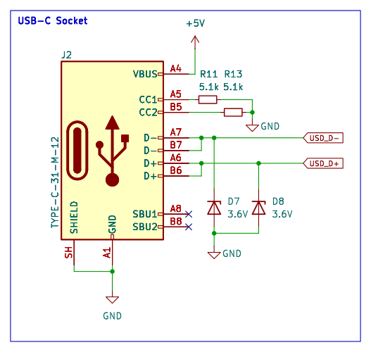

<!-- AUTO-GENERATED — do not edit, this file is overwritten on every push to main -->

# USB-C_Socket_FullSpeed

 

USB 2.0 Type-C receptacle for full-speed devices (HRO TYPE-C-31-M-12), 5.1k pulldowns on CC1/CC2 for 5V sink, 3.6V zener clamps on D+/D-. No 1.5k data pull-up: full-speed devices with an internal pull-up (CH340, RP2040, STM32) connect directly. Socket and ESD are LCSC Extended (no Basic alternative exists in the JLC catalogue); the CC resistors are Basic. Layout included. Superseded by USB-C_Socket_FullSpeed_SRV05, which uses an SRV05-4 array instead of the zeners (roughly 300x lower line capacitance, nanosecond clamping, also protects CC1/CC2); kept as the simpler variant when a zener is acceptable.

## Bill of Materials

*Manufacturer and MPN fetched automatically from [LCSC](https://lcsc.com).*

| Refs | Value | Footprint | LCSC | JLCPCB | Manufacturer | MPN | Category |
| --- | --- | --- | --- | --- | --- | --- | --- |
| D7, D8 | 3.6V | D_SOD-123 | C22395524 | — | — | — | — |
| J2 | TYPE-C-31-M-12 | USB_C_Receptacle_HRO_TYPE-C-31-M-12 | C165948 | — | — | — | — |
| R11, R13 | 5.1k | R_0603_1608Metric | C23186 | — | — | — | — |

---
*Keywords: usb usb-c type-c connector full-speed sink cc-resistor esd*

| | |
|---|---|
| Maturity | Layout |
| LCSC Parts | Yes |
| JLCPCB | Optimized for Basic Parts |
| 3D Models | Partial |
| Reviewed | No |
