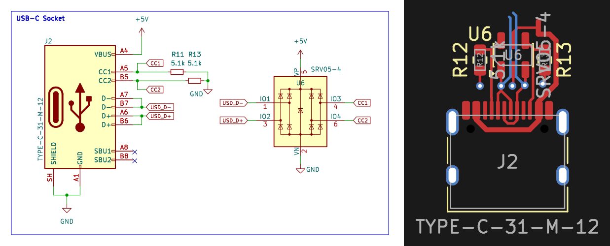

<!-- AUTO-GENERATED — do not edit, this file is overwritten on every push to main -->

# USB-C_Socket_FullSpeed_SRV05

 

USB 2.0 Type-C receptacle (HRO TYPE-C-31-M-12) as a 5V sink for full-speed devices: 5.1k pulldowns on CC1/CC2, ESD array SRV05-4 (SOT-23-6, 0.3 pF, 4 channels) protecting D+, D-, CC1 and CC2, VP tied to VBUS (5V), VN to GND. No 1.5k data pull-up - full-speed devices with an internal pull-up (CH340, RP2040, STM32) connect directly. Preferred over USB-C_Socket_FullSpeed, which uses two 3.6V zeners: the array has roughly 300x lower line capacitance, clamps in nanoseconds instead of microseconds and also protects the CC lines. Socket and ESD array are LCSC Extended (the JLC catalogue has no Basic ESD part); the 5.1k resistors are Basic. Schematic and layout included; the USB-C footprint lives in the project library GnssFanout, so the block is used inside projects of this repo family.

## Bill of Materials

*Manufacturer and MPN fetched automatically from [LCSC](https://lcsc.com).*

| Refs | Value | Footprint | LCSC | JLCPCB | Manufacturer | MPN | Category |
| --- | --- | --- | --- | --- | --- | --- | --- |
| J2 | TYPE-C-31-M-12 | USB_C_Receptacle_HRO_TYPE-C-31-M-12 | C165948 | — | — | — | — |
| R11, R13 | 5.1k | R_0603_1608Metric | C23186 | — | — | — | — |
| U6 | SRV05-4 | SOT-23-6 | C558418 | — | — | — | — |

---
*Keywords: usb usb-c type-c connector full-speed 5v sink cc-resistor esd srv05 tvs*

| | |
|---|---|
| Maturity | Layout |
| LCSC Parts | Yes |
| JLCPCB | Optimized for Basic Parts |
| 3D Models | Yes |
| Reviewed | No |
